# 🗄️ Schéma de la Base de Données — THIEBBRO IMMO

> **Plateforme PropTech Immobilière & Investissement (Côte d'Ivoire)**  
> Moteur de Base de Données : **PostgreSQL**  
> ORM : **Django ORM** (Architecture Clean Architecture / DDD)  
> Date de génération : Octobre 2026  

---

## 🗺️ 1. Diagramme Entité-Relation Global (Mermaid ERD)

```mermaid
erDiagram
    %% ==========================================
    %% ENTITÉS UTILISATEURS & AUTH
    %% ==========================================
    USER ||--o{ PROPERTY : "conseiller_responsable (assigned_agent)"
    USER ||--o{ PROPERTY_FAVORITE : "enregistre (user)"
    USER ||--o{ LEAD : "compte_lie (user)"
    USER ||--o{ LEAD : "conseiller_affecte (assigned_agent)"
    USER ||--o{ PROPERTY_INQUIRY : "auteur_demande (user)"
    USER ||--o{ VISIT_REQUEST : "visiteur (user)"

    %% ==========================================
    %% ENTITÉS IMMOBILIER & PROGRAMMES
    %% ==========================================
    DEVELOPMENT_PROJECT ||--o{ PROJECT_LOT : "contient_lots"
    DEVELOPMENT_PROJECT ||--o{ PROPERTY : "rattache_programme"
    
    PROPERTY ||--o{ PROPERTY_IMAGE : "galerie_photos"
    PROPERTY ||--o{ PROPERTY_FAVORITE : "mis_en_favoris_par"
    PROPERTY ||--o{ LEAD : "bien_consulte (consulted_property)"
    PROPERTY ||--o{ PROPERTY_INQUIRY : "bien_concerne"
    PROPERTY ||--o{ VISIT_REQUEST : "bien_visite"

    %% ==========================================
    %% ENTITÉS CRM & COMMERCE
    %% ==========================================
    LEAD ||--o{ CRM_INTERACTION : "historique_echanges"
    LEAD ||--o{ PROPERTY_INQUIRY : "demandes_envoyees"
    LEAD ||--o{ VISIT_REQUEST : "demandes_rdv"

    %% ==========================================
    %% DÉFINITIONS DES TABLES
    %% ==========================================

    USER {
        bigint id PK
        string email UK "Adresse email unique (identifiant)"
        string password "Mot de passe hashé"
        string first_name "Prénom"
        string last_name "Nom"
        string phone_number "Téléphone (ex: +225...)"
        string country_of_residence "Pays de résidence"
        boolean is_diaspora "Membre de la diaspora"
        enum role "PARTICULIER, INVESTISSEUR, PROPRIETAIRE, PROMOTEUR, AGENT, ADMIN"
        enum project_objective "HABITER, INVESTIR, LOUER, AUTRE"
        decimal project_budget "Budget envisagé en FCFA"
        decimal project_down_payment "Apport disponible en FCFA"
        string project_zone "Zone souhaitée (ex: Cocody, Bingerville)"
        enum project_timeframe "IMMEDIAT, 0_3_MOIS, 3_6_MOIS, 6_12_MOIS, PLUS_TARD"
        boolean notifications_enabled "Notifications actives"
        boolean is_active "Compte actif"
        boolean is_staff "Accès console admin"
        boolean is_superuser "Super-administrateur"
        datetime created_at "Date inscription"
        datetime updated_at "Dernière modification"
    }

    DEVELOPMENT_PROJECT {
        uuid id PK "Identifiant UUIDv4"
        string name "Nom du programme neuf"
        string slug UK "Identifiant URL convivial"
        string developer_name "Promoteur immobilier"
        string city "Ville (Abidjan)"
        string commune "Commune (Cocody, etc.)"
        string neighborhood "Quartier (ex: Abatta)"
        text description "Présentation complète"
        integer total_lots_count "Nombre total de logements"
        string delivery_date "Calendrier livraison (ex: T4 2026)"
        decimal starting_price "Prix à partir de (FCFA)"
        string cover_image "Image principale de couverture"
        string brochure_pdf "Document / Plaquette PDF"
        string virtual_tour_url "Lien visite virtuelle 3D"
        boolean is_featured "Mise en avant sur l'accueil"
        datetime created_at "Date de création"
    }

    PROJECT_LOT {
        uuid id PK "Identifiant UUIDv4"
        uuid project_id FK "Référence au programme"
        string lot_number "Numéro / Réf de lot (ex: Lot 101)"
        enum typology "F1, F2, F3, F4, F5, AUTRE"
        string building_name "Bâtiment / Tour (ex: Tour A)"
        integer floor "Numéro d'étage"
        decimal surface_sqm "Superficie en m²"
        decimal price "Prix de vente en FCFA"
        enum status "DISPONIBLE, OPTION, RESERVE, VENDU, ARCHIVE"
    }

    PROPERTY {
        uuid id PK "Identifiant UUIDv4"
        string reference UK "Code de référence unique (ex: THI-2026-001)"
        string title "Titre de l'annonce"
        string slug UK "Slug unique pour URL"
        text description "Description détaillée du bien"
        enum property_type "APPARTEMENT, VILLA, MAISON, DUPLEX, TERRAIN, IMMEUBLE, RESIDENCE_MEUBLEE, BUREAU, COMMERCIAL"
        enum typology "F1, F2, F3, F4, F5, AUTRE"
        enum target_goal "HABITATION, INVESTISSEMENT, MIXTE, LOCATION"
        enum status "BROUILLON, EN_ATTENTE, DISPONIBLE, OPTION, RESERVE, VENDU, ARCHIVE"
        enum verification_status "NON_VERIFIE, EN_ATTENTE, VERIFIE, VERIFICATION_RENFORCEE"
        boolean is_featured "En vedette sur l'accueil"
        boolean is_selected_investment "Sélectionné investissement rentable"
        decimal price "Prix de vente ou loyer (FCFA)"
        decimal recommended_down_payment "Apport recommandé (FCFA)"
        decimal estimated_monthly_rent "Loyer estimatif mensuel (FCFA)"
        decimal estimated_yield_rate "Rentabilité brute calculée (%)"
        integer investment_score "Indice IA THIEBBRO (0-100)"
        string city "Ville (ex: Abidjan)"
        string commune "Commune (ex: Cocody)"
        string neighborhood "Quartier (ex: Palmeraie)"
        string address "Adresse / Repère géographique"
        decimal latitude "Coordonnée GPS latitude"
        decimal longitude "Coordonnée GPS longitude"
        decimal surface_sqm "Superficie en m²"
        integer rooms_count "Nombre total de pièces"
        integer bedrooms_count "Nombre de chambres"
        integer bathrooms_count "Nombre de salles d'eau / bains"
        boolean has_parking "Présence parking"
        boolean has_swimming_pool "Présence piscine"
        boolean has_elevator "Présence ascenseur"
        boolean has_security "Sécurité 24/7"
        boolean has_generator "Groupe électrogène de secours"
        boolean has_green_space "Jardin / Espace vert"
        string video_url "Lien vidéo / Drone"
        string virtual_tour_url "Lien visite 3D Matterport"
        bigint assigned_agent_id FK "Conseiller responsable"
        uuid development_project_id FK "Programme neuf rattaché"
        datetime created_at "Date d'ajout"
        datetime updated_at "Dernière mise à jour"
    }

    PROPERTY_IMAGE {
        uuid id PK "Identifiant UUIDv4"
        uuid property_id FK "Bien rattaché"
        string image "Fichier image média"
        string caption "Légende descriptive"
        boolean is_cover "Photo de couverture"
        integer order "Ordre d'affichage"
    }

    PROPERTY_FAVORITE {
        uuid id PK "Identifiant UUIDv4"
        bigint user_id FK "Utilisateur qui a liké"
        uuid property_id FK "Bien mis en favori"
        datetime created_at "Date d'ajout en favoris"
    }

    LEAD {
        uuid id PK "Identifiant UUIDv4"
        bigint user_id FK "Compte utilisateur (optionnel)"
        string full_name "Nom et prénom du prospect"
        string phone_number "Téléphone direct"
        string whatsapp_number "Numéro WhatsApp"
        string email "Adresse email"
        string country_of_residence "Pays de résidence"
        boolean is_diaspora "Prospect diaspora"
        string objective "Objectif (Habiter, Investir...)"
        string property_type "Type de bien recherché"
        string preferred_zone "Zone géographique souhaitée"
        decimal budget "Budget maximum (FCFA)"
        decimal down_payment "Apport disponible (FCFA)"
        string timeframe "Délai de réalisation"
        uuid consulted_property_id FK "Bien consulté"
        enum source "APPLICATION, SITE_WEB, WHATSAPP, TROUVER_MON_BIEN, DEMANDE_INFO, VISITE, ESPACE_DIASPORA, SIMULATEUR, AUTRE"
        enum stage "NOUVEAU, CONTACTE, QUALIFIE, RDV, VISITE, PROPOSITION, NEGOCIATION, RESERVATION, VENTE, PERDU"
        integer score "Score d'intention (0-100)"
        enum temperature "FROID, TIEDE, CHAUD, TRES_CHAUD"
        bigint assigned_agent_id FK "Conseiller assigné"
        datetime last_interaction_at "Date dernière interaction"
        string next_action "Prochaine action à mener"
        text commercial_notes "Notes & compte-rendu commercial"
        datetime created_at "Date d'entrée dans le pipe"
        datetime updated_at "Dernière mise à jour"
    }

    CRM_INTERACTION {
        uuid id PK "Identifiant UUIDv4"
        uuid lead_id FK "Prospect concerné"
        string interaction_type "Type (WHATSAPP_CLICK, CALL, NOTE, EMAIL)"
        text details "Détails de l'interaction"
        datetime created_at "Date et heure"
    }

    PROPERTY_INQUIRY {
        uuid id PK "Identifiant UUIDv4"
        uuid property_id FK "Bien immobilier ciblé"
        uuid lead_id FK "Fiche prospect associée"
        bigint user_id FK "Compte utilisateur connecté"
        string objective "Objectif de la demande"
        text message "Message rédigé par le prospect"
        boolean is_processed "Traité par l'équipe commerciale"
        datetime created_at "Date de soumission"
    }

    VISIT_REQUEST {
        uuid id PK "Identifiant UUIDv4"
        uuid property_id FK "Bien à visiter"
        uuid lead_id FK "Fiche prospect associée"
        bigint user_id FK "Compte utilisateur connecté"
        enum visit_type "PHYSIQUE, VISIO"
        enum status "EN_ATTENTE, CONFIRMEE, EFFECTUEE, ANNULEE"
        date scheduled_date "Date fixée"
        time scheduled_time "Heure fixée"
        text notes "Consignes & remarques"
        datetime created_at "Date de création de la demande"
    }
```

---

## 📋 2. Dictionnaire des Tables et Champs

### A. Domaine `users` (Authentification & Profils)

#### Table `users_user`
Table centrale des utilisateurs héritant d'AbstractUser de Django.
- **Clé primaire** : `id` (`BIGSERIAL` / `bigint`)
- **Contrainte unique** : `email` (`VARCHAR(254) UNIQUE`)

| Champ | Type SQL | Nullable | Description / Valeurs |
| :--- | :--- | :---: | :--- |
| `id` | `BIGINT GENERATED BY DEFAULT AS IDENTITY` | ❌ Non | Identifiant séquentiel de l'utilisateur |
| `email` | `VARCHAR(254)` | ❌ Non | Identifiant unique de connexion |
| `password` | `VARCHAR(128)` | ❌ Non | Hash sécurisé PBKDF2/Argon2 |
| `first_name` | `VARCHAR(150)` | ❌ Non | Prénom de l'utilisateur |
| `last_name` | `VARCHAR(150)` | ❌ Non | Nom de famille |
| `phone_number` | `VARCHAR(30)` | ❌ Non | Téléphone mobile (avec indicatif +225) |
| `country_of_residence`| `VARCHAR(100)` | ❌ Non | Pays de résidence (Défaut: `'Côte d\'Ivoire'`) |
| `is_diaspora` | `BOOLEAN` | ❌ Non | `TRUE` si vit hors de Côte d'Ivoire |
| `role` | `VARCHAR(20)` | ❌ Non | Rôle : `PARTICULIER`, `INVESTISSEUR`, `PROPRIETAIRE`, `PROMOTEUR`, `AGENT`, `ADMIN` |
| `project_objective` | `VARCHAR(30)` | ✔️ Oui | Objectif : `HABITER`, `INVESTIR`, `LOUER`, `AUTRE` |
| `project_budget` | `NUMERIC(14, 2)` | ✔️ Oui | Budget d'achat envisagé en FCFA |
| `project_down_payment`| `NUMERIC(14, 2)` | ✔️ Oui | Apport personnel disponible en FCFA |
| `project_zone` | `VARCHAR(150)` | ❌ Non | Communes préférées (ex: Cocody, Bingerville) |
| `project_timeframe` | `VARCHAR(30)` | ✔️ Oui | Délai : `IMMEDIAT`, `0_3_MOIS`, `3_6_MOIS`, `6_12_MOIS`, `PLUS_TARD` |
| `notifications_enabled`| `BOOLEAN` | ❌ Non | Active/désactive les alertes push/email |
| `is_active` | `BOOLEAN` | ❌ Non | Indicateur de compte actif |
| `is_staff` | `BOOLEAN` | ❌ Non | Droit d'accès au panneau d'administration |
| `is_superuser` | `BOOLEAN` | ❌ Non | Super-droits complets |
| `last_login` | `TIMESTAMPTZ` | ✔️ Oui | Date/heure de dernière connexion |
| `created_at` | `TIMESTAMPTZ` | ❌ Non | Date de création automatique (`now()`) |
| `updated_at` | `TIMESTAMPTZ` | ❌ Non | Date de dernière mise à jour |

---

### B. Domaine `properties` (Catalogue, Programmes Neufs & Favoris)

#### Table `properties_developmentproject` (Programmes Neufs)
Regroupe les opérations de promotion immobilière composées de multiples lots.
- **Clé primaire** : `id` (`UUID`)
- **Contrainte unique** : `slug` (`VARCHAR(200) UNIQUE`)

| Champ | Type SQL | Nullable | Description / Valeurs |
| :--- | :--- | :---: | :--- |
| `id` | `UUID` | ❌ Non | Identifiant unique universel |
| `name` | `VARCHAR(200)` | ❌ Non | Nom du programme (ex: *Résidence L'Étoile*) |
| `slug` | `VARCHAR(200)` | ❌ Non | Slug unique pour les URLs web |
| `developer_name` | `VARCHAR(150)` | ❌ Non | Nom de la société promotrice |
| `city` | `VARCHAR(100)` | ❌ Non | Ville (Défaut: `'Abidjan'`) |
| `commune` | `VARCHAR(100)` | ❌ Non | Commune (ex: Cocody, Marcory...) |
| `neighborhood` | `VARCHAR(100)` | ❌ Non | Quartier (ex: Riviera Palmeraie) |
| `description` | `TEXT` | ❌ Non | Présentation complète du programme |
| `total_lots_count` | `INTEGER` | ❌ Non | Nombre total de lots / appartements |
| `delivery_date` | `VARCHAR(100)` | ❌ Non | Échéance de livraison (ex: *T4 2026*) |
| `starting_price` | `NUMERIC(14, 2)` | ❌ Non | Prix de vente minimum (FCFA) |
| `cover_image` | `VARCHAR(100)` | ✔️ Oui | Chemin média de la photo de couverture |
| `brochure_pdf` | `VARCHAR(100)` | ✔️ Oui | Fichier PDF de la plaquette commerciale |
| `virtual_tour_url` | `VARCHAR(200)` | ✔️ Oui | URL vers la maquette 3D / Visite virtuelle |
| `is_featured` | `BOOLEAN` | ❌ Non | Mis en avant en première page (`TRUE`/`FALSE`) |
| `created_at` | `TIMESTAMPTZ` | ❌ Non | Date de création |

#### Table `properties_projectlot` (Lots d'un Programme)
- **Clé primaire** : `id` (`UUID`)
- **Clé étrangère** : `project_id` -> `properties_developmentproject(id)` `ON DELETE CASCADE`

| Champ | Type SQL | Nullable | Description / Valeurs |
| :--- | :--- | :---: | :--- |
| `id` | `UUID` | ❌ Non | Identifiant unique du lot |
| `project_id` | `UUID` | ❌ Non | Clé étrangère vers le programme parent |
| `lot_number` | `VARCHAR(50)` | ❌ Non | Référence de lot (ex: *Lot B102*) |
| `typology` | `VARCHAR(20)` | ❌ Non | `F1`, `F2`, `F3`, `F4`, `F5`, `AUTRE` |
| `building_name` | `VARCHAR(50)` | ❌ Non | Bâtiment ou Tour (ex: *Bâtiment A*) |
| `floor` | `INTEGER` | ❌ Non | Étage (0 = RDC, 1 = 1er étage...) |
| `surface_sqm` | `NUMERIC(8, 2)` | ❌ Non | Superficie habitable en m² |
| `price` | `NUMERIC(14, 2)` | ❌ Non | Prix du lot en FCFA |
| `status` | `VARCHAR(20)` | ❌ Non | `DISPONIBLE`, `OPTION`, `RESERVE`, `VENDU`, `ARCHIVE` |

#### Table `properties_property` (Biens Immobiliers Individuels)
Table centrale du catalogue des biens.
- **Clé primaire** : `id` (`UUID`)
- **Contraintes uniques** : `reference` (`VARCHAR(50) UNIQUE`), `slug` (`VARCHAR(255) UNIQUE`)
- **Clés étrangères** : 
  - `assigned_agent_id` -> `users_user(id)` `ON DELETE SET NULL`
  - `development_project_id` -> `properties_developmentproject(id)` `ON DELETE SET NULL`

| Champ | Type SQL | Nullable | Description / Valeurs |
| :--- | :--- | :---: | :--- |
| `id` | `UUID` | ❌ Non | Identifiant universel |
| `reference` | `VARCHAR(50)` | ❌ Non | Code référence (ex: `THI-2026-001`) |
| `title` | `VARCHAR(255)` | ❌ Non | Titre commercial du bien |
| `slug` | `VARCHAR(255)` | ❌ Non | Slug unique d'URL |
| `description` | `TEXT` | ❌ Non | Description détaillée |
| `property_type` | `VARCHAR(30)` | ❌ Non | `APPARTEMENT`, `VILLA`, `MAISON`, `DUPLEX`, `TERRAIN`, `IMMEUBLE`, `RESIDENCE_MEUBLEE`, `BUREAU`, `COMMERCIAL` |
| `typology` | `VARCHAR(20)` | ❌ Non | `F1`, `F2`, `F3`, `F4`, `F5`, `AUTRE` |
| `target_goal` | `VARCHAR(20)` | ❌ Non | `HABITATION`, `INVESTISSEMENT`, `MIXTE`, `LOCATION` |
| `status` | `VARCHAR(20)` | ❌ Non | `BROUILLON`, `EN_ATTENTE`, `DISPONIBLE`, `OPTION`, `RESERVE`, `VENDU`, `ARCHIVE` |
| `verification_status` | `VARCHAR(30)` | ❌ Non | `NON_VERIFIE`, `EN_ATTENTE`, `VERIFIE`, `VERIFICATION_RENFORCEE` |
| `is_featured` | `BOOLEAN` | ❌ Non | Opportunité du moment sur la page d'accueil |
| `is_selected_investment` | `BOOLEAN` | ❌ Non | Coup de cœur rentabilité espace Investisseur |
| `price` | `NUMERIC(14, 2)` | ❌ Non | Prix de vente ou prix de transaction (FCFA) |
| `recommended_down_payment`| `NUMERIC(14, 2)`| ✔️ Oui | Apport recommandé en FCFA |
| `estimated_monthly_rent`| `NUMERIC(12, 2)` | ✔️ Oui | Loyer mensuel estimé en FCFA |
| `estimated_yield_rate` | `NUMERIC(5, 2)` | ✔️ Oui | Rentabilité brute estimative en % |
| `investment_score` | `INTEGER` | ❌ Non | Score algorithmique THIEBBRO (0 à 100) |
| `city` | `VARCHAR(100)` | ❌ Non | Ville (Abidjan) |
| `commune` | `VARCHAR(100)` | ❌ Non | Commune (Cocody, Bingerville, Marcory...) |
| `neighborhood` | `VARCHAR(100)` | ❌ Non | Quartier précis (Angré, Riviera, Zone 4...) |
| `address` | `VARCHAR(255)` | ❌ Non | Adresse / Repère précis |
| `latitude` | `NUMERIC(9, 6)` | ✔️ Oui | Latitude GPS |
| `longitude` | `NUMERIC(9, 6)` | ✔️ Oui | Longitude GPS |
| `surface_sqm` | `NUMERIC(8, 2)` | ❌ Non | Surface utile en mètres carrés |
| `rooms_count` | `INTEGER` | ❌ Non | Nombre de pièces |
| `bedrooms_count` | `INTEGER` | ❌ Non | Nombre de chambres |
| `bathrooms_count` | `INTEGER` | ❌ Non | Nombre de salles de bains / eau |
| `has_parking` | `BOOLEAN` | ❌ Non | Dispose d'un garage ou parking |
| `has_swimming_pool`| `BOOLEAN` | ❌ Non | Dispose d'une piscine |
| `has_elevator` | `BOOLEAN` | ❌ Non | Immeuble avec ascenseur |
| `has_security` | `BOOLEAN` | ❌ Non | Gardiennage et sécurité 24/7 |
| `has_generator` | `BOOLEAN` | ❌ Non | Groupe électrogène disponible |
| `has_green_space`| `BOOLEAN` | ❌ Non | Présence jardin ou espaces verts |
| `video_url` | `VARCHAR(200)` | ✔️ Oui | URL vidéo YouTube / Vimeo / Drone |
| `virtual_tour_url`| `VARCHAR(200)` | ✔️ Oui | URL visite virtuelle Matterport 3D |
| `assigned_agent_id`| `BIGINT` | ✔️ Oui | FK vers l'agent commercial responsable |
| `development_project_id`| `UUID` | ✔️ Oui | FK vers le programme neuf associé |
| `created_at` | `TIMESTAMPTZ` | ❌ Non | Date de création |
| `updated_at` | `TIMESTAMPTZ` | ❌ Non | Date de dernière modification |

#### Table `properties_propertyimage` (Photos)
- **Clé primaire** : `id` (`UUID`)
- **Clé étrangère** : `property_id` -> `properties_property(id)` `ON DELETE CASCADE`

| Champ | Type SQL | Nullable | Description / Valeurs |
| :--- | :--- | :---: | :--- |
| `id` | `UUID` | ❌ Non | Identifiant universel |
| `property_id` | `UUID` | ❌ Non | Bien rattaché |
| `image` | `VARCHAR(100)` | ❌ Non | Fichier image sur le stockage média |
| `caption` | `VARCHAR(150)` | ❌ Non | Légende descriptive |
| `is_cover` | `BOOLEAN` | ❌ Non | Photo principale (`TRUE`) |
| `order` | `INTEGER` | ❌ Non | Ordre d'affichage (0, 1, 2...) |

#### Table `properties_propertyfavorite` (Favoris)
- **Clé primaire** : `id` (`UUID`)
- **Contrainte unique composite** : `(user_id, property_id)` UNIQUE
- **Clés étrangères** : 
  - `user_id` -> `users_user(id)` `ON DELETE CASCADE`
  - `property_id` -> `properties_property(id)` `ON DELETE CASCADE`

| Champ | Type SQL | Nullable | Description / Valeurs |
| :--- | :--- | :---: | :--- |
| `id` | `UUID` | ❌ Non | Identifiant du favori |
| `user_id` | `BIGINT` | ❌ Non | Utilisateur qui a sauvegardé |
| `property_id` | `UUID` | ❌ Non | Bien immobilier enregistré |
| `created_at` | `TIMESTAMPTZ` | ❌ Non | Date de l'enregistrement |

---

### C. Domaine `crm` (Pipeline Commercial, Prospects, Interactions & Visites)

#### Table `crm_lead` (Prospects & Pipeline Kanban)
- **Clé primaire** : `id` (`UUID`)
- **Clés étrangères** :
  - `user_id` -> `users_user(id)` `ON DELETE SET NULL`
  - `consulted_property_id` -> `properties_property(id)` `ON DELETE SET NULL`
  - `assigned_agent_id` -> `users_user(id)` `ON DELETE SET NULL`

| Champ | Type SQL | Nullable | Description / Valeurs |
| :--- | :--- | :---: | :--- |
| `id` | `UUID` | ❌ Non | Identifiant unique du lead |
| `user_id` | `BIGINT` | ✔️ Oui | Compte utilisateur s'il est inscrit |
| `full_name` | `VARCHAR(200)` | ❌ Non | Nom complet du contact |
| `phone_number` | `VARCHAR(30)` | ❌ Non | Téléphone |
| `whatsapp_number` | `VARCHAR(30)` | ❌ Non | Numéro WhatsApp |
| `email` | `VARCHAR(254)` | ❌ Non | Email de contact |
| `country_of_residence`| `VARCHAR(100)` | ❌ Non | Pays de résidence |
| `is_diaspora` | `BOOLEAN` | ❌ Non | Prospect membre de la diaspora |
| `objective` | `VARCHAR(100)` | ❌ Non | Objectif (*Habiter*, *Investir*, *Louer*...) |
| `property_type` | `VARCHAR(100)` | ❌ Non | Type de bien convoité |
| `preferred_zone` | `VARCHAR(150)` | ❌ Non | Quartier ou commune souhaité(e) |
| `budget` | `NUMERIC(14, 2)` | ✔️ Oui | Budget total en FCFA |
| `down_payment` | `NUMERIC(14, 2)` | ✔️ Oui | Apport comptant en FCFA |
| `timeframe` | `VARCHAR(100)` | ❌ Non | Horizon de réalisation |
| `consulted_property_id`| `UUID` | ✔️ Oui | Bien immobilier spécifique consulté |
| `source` | `VARCHAR(40)` | ❌ Non | `APPLICATION`, `SITE_WEB`, `WHATSAPP`, `TROUVER_MON_BIEN`, `DEMANDE_INFO`, `VISITE`, `ESPACE_DIASPORA`, `SIMULATEUR`, `AUTRE` |
| `stage` | `VARCHAR(30)` | ❌ Non | `NOUVEAU`, `CONTACTE`, `QUALIFIE`, `RDV`, `VISITE`, `PROPOSITION`, `NEGOCIATION`, `RESERVATION`, `VENTE`, `PERDU` |
| `score` | `INTEGER` | ❌ Non | Score d'intention (0 à 100) |
| `temperature` | `VARCHAR(20)` | ❌ Non | `FROID`, `TIEDE`, `CHAUD`, `TRES_CHAUD` |
| `assigned_agent_id` | `BIGINT` | ✔️ Oui | Conseiller commercial responsable |
| `last_interaction_at`| `TIMESTAMPTZ`| ❌ Non | Horodatage de la dernière action |
| `next_action` | `VARCHAR(255)` | ❌ Non | Prochaine relance ou étape |
| `commercial_notes` | `TEXT` | ❌ Non | Historique et mémos de négociation |
| `created_at` | `TIMESTAMPTZ` | ❌ Non | Date d'entrée du prospect |
| `updated_at` | `TIMESTAMPTZ` | ❌ Non | Date de mise à jour |

#### Table `crm_crminteraction` (Journal des Activités Commerciales)
- **Clé primaire** : `id` (`UUID`)
- **Clé étrangère** : `lead_id` -> `crm_lead(id)` `ON DELETE CASCADE`

| Champ | Type SQL | Nullable | Description / Valeurs |
| :--- | :--- | :---: | :--- |
| `id` | `UUID` | ❌ Non | Identifiant de l'interaction |
| `lead_id` | `UUID` | ❌ Non | Lead rattaché |
| `interaction_type` | `VARCHAR(50)` | ❌ Non | `WHATSAPP_CLICK`, `CALL`, `INQUIRY`, `NOTE`, `EMAIL` |
| `details` | `TEXT` | ❌ Non | Contenu ou retranscription |
| `created_at` | `TIMESTAMPTZ` | ❌ Non | Horodatage de l'interaction |

#### Table `crm_propertyinquiry` (Demandes d'Informations)
- **Clé primaire** : `id` (`UUID`)
- **Clés étrangères** :
  - `property_id` -> `properties_property(id)` `ON DELETE CASCADE`
  - `lead_id` -> `crm_lead(id)` `ON DELETE CASCADE`
  - `user_id` -> `users_user(id)` `ON DELETE SET NULL`

| Champ | Type SQL | Nullable | Description / Valeurs |
| :--- | :--- | :---: | :--- |
| `id` | `UUID` | ❌ Non | Identifiant de la demande |
| `property_id` | `UUID` | ❌ Non | Bien immobilier ciblé |
| `lead_id` | `UUID` | ❌ Non | Fiche prospect associée |
| `user_id` | `BIGINT` | ✔️ Oui | Utilisateur connecté (si applicable) |
| `objective` | `VARCHAR(100)` | ❌ Non | Motivation du prospect |
| `message` | `TEXT` | ❌ Non | Message personnalisé |
| `is_processed` | `BOOLEAN` | ❌ Non | Traitée par un agent (`TRUE`/`FALSE`) |
| `created_at` | `TIMESTAMPTZ` | ❌ Non | Date de soumission |

#### Table `crm_visitrequest` (Rendez-vous & Visites de Biens)
- **Clé primaire** : `id` (`UUID`)
- **Clés étrangères** :
  - `property_id` -> `properties_property(id)` `ON DELETE CASCADE`
  - `lead_id` -> `crm_lead(id)` `ON DELETE CASCADE`
  - `user_id` -> `users_user(id)` `ON DELETE SET NULL`

| Champ | Type SQL | Nullable | Description / Valeurs |
| :--- | :--- | :---: | :--- |
| `id` | `UUID` | ❌ Non | Identifiant de la visite |
| `property_id` | `UUID` | ❌ Non | Bien à visiter |
| `lead_id` | `UUID` | ❌ Non | Prospect |
| `user_id` | `BIGINT` | ✔️ Oui | Compte utilisateur connecté |
| `visit_type` | `VARCHAR(20)` | ❌ Non | `PHYSIQUE` (sur site) ou `VISIO` (à distance / diaspora) |
| `status` | `VARCHAR(20)` | ❌ Non | `EN_ATTENTE`, `CONFIRMEE`, `EFFECTUEE`, `ANNULEE` |
| `scheduled_date` | `DATE` | ❌ Non | Date du rendez-vous |
| `scheduled_time` | `TIME` | ❌ Non | Heure du rendez-vous |
| `notes` | `TEXT` | ❌ Non | Remarques / Instructions d'accès |
| `created_at` | `TIMESTAMPTZ` | ❌ Non | Date de demande |

---

## 🔢 3. Récapitulatif des Énumérations (Enums)

| Énumération Django | Valeurs (Code / Libellé) |
| :--- | :--- |
| **`UserRole`** | `PARTICULIER` (Client Particulier), `INVESTISSEUR` (Investisseur), `PROPRIETAIRE` (Propriétaire), `PROMOTEUR` (Promoteur Immobilier), `AGENT` (Conseiller Commercial), `ADMIN` (Administrateur) |
| **`PropertyType`** | `APPARTEMENT`, `VILLA`, `MAISON`, `DUPLEX`, `TERRAIN`, `IMMEUBLE`, `RESIDENCE_MEUBLEE`, `BUREAU`, `COMMERCIAL` |
| **`PropertyTypology`**| `F1` (Studio), `F2` (2 pièces), `F3` (3 pièces), `F4` (4 pièces), `F5` (5 pièces et +), `AUTRE` |
| **`PropertyGoal`** | `HABITATION`, `INVESTISSEMENT`, `MIXTE`, `LOCATION` |
| **`PropertyStatus`** | `BROUILLON`, `EN_ATTENTE`, `DISPONIBLE`, `OPTION`, `RESERVE`, `VENDU`, `ARCHIVE` |
| **`VerificationStatus`**| `NON_VERIFIE`, `EN_ATTENTE`, `VERIFIE` (Documents certifiés), `VERIFICATION_RENFORCEE` (ACD / Titre vérifié) |
| **`PipelineStage`** | `NOUVEAU`, `CONTACTE`, `QUALIFIE`, `RDV`, `VISITE`, `PROPOSITION`, `NEGOCIATION`, `RESERVATION`, `VENTE`, `PERDU` |
| **`LeadTemperature`** | `FROID` (0-39), `TIEDE` (40-69), `CHAUD` (70-89), `TRES_CHAUD` (90-100) |
| **`LeadSource`** | `APPLICATION`, `SITE_WEB`, `WHATSAPP`, `TROUVER_MON_BIEN`, `DEMANDE_INFO`, `VISITE`, `ESPACE_DIASPORA`, `SIMULATEUR`, `AUTRE` |
| **`VisitRequestType`**| `PHYSIQUE`, `VISIO` |
| **`VisitRequestStatus`**| `EN_ATTENTE`, `CONFIRMEE`, `EFFECTUEE`, `ANNULEE` |

---

## 🔒 4. Règles d'Intégrité Référentielle

- **`ON DELETE CASCADE`** :
  - Suppression d'un `DevelopmentProject` -> Supprime en cascade ses lots `ProjectLot`.
  - Suppression d'une `Property` -> Supprime en cascade ses photos `PropertyImage`, ses favoris `PropertyFavorite`, ses demandes d'infos `PropertyInquiry` et ses visites `VisitRequest`.
  - Suppression d'un `Lead` -> Supprime en cascade son historique `CRMInteraction`, ses `PropertyInquiry` et ses `VisitRequest`.
- **`ON DELETE SET NULL`** :
  - Suppression d'un utilisateur `User` ou d'un agent -> Met à `NULL` `assigned_agent_id` ou `user_id` sans détruire les biens ni les prospects historiques.
  - Suppression d'un `DevelopmentProject` -> Met à `NULL` `development_project_id` sur la `Property` sans supprimer le bien immobilier.
